# AI Research Automation Pipeline (n8n + Google Gemini + Pinecone)

> Production-grade, importable, locally testable AI research and Retrieval-Augmented Generation (RAG) automation engine built with **n8n**, **Google Gemini**, **Pinecone Vector Database**, **Google News RSS**, and **Gmail**.

[](scripts/validate-workflows.sh)
[](scripts/test-mocked-pipeline.js)
[](https://n8n.io)
[](https://ai.google.dev)
[](https://pinecone.io)
[](LICENSE)

---

## Table of Contents
1. [Project Overview](#project-overview)
2. [System Architecture](#system-architecture)
3. [Key Features](#key-features)
4. [Technology Stack](#technology-stack)
5. [Repository Structure](#repository-structure)
6. [Prerequisites & Local Startup](#prerequisites--local-startup)
7. [Credential & Account Setup](#credential--account-setup)
8. [Import & Workflow Configuration](#import--workflow-configuration)
9. [Web Developer Node Breakdown](#web-developer-node-breakdown)
10. [Testing Suite (Levels 1, 2 & 3)](#testing-suite)
11. [Make & Zapier Comparison Exercise](#make--zapier-comparison-exercise)
12. [Cost, Quotas & Rate Limits](#cost-quotas--rate-limits)
13. [Limitations of RSS-Based Discovery](#limitations-of-rss-based-discovery)
14. [Security & Privacy Practices](#security--privacy-practices)
15. [GitHub Publication](#github-publication)

---

## 1. Project Overview

The **AI Research Automation Pipeline** is an autonomous intelligence system that eliminates the manual burden of tracking emerging technological breakthroughs. It automates:
1. **Discovery**: Ingests fresh articles via Google News RSS on a daily cron (8:00 AM) or on-demand via REST Webhook.
2. **Analysis & Structured Synthesis**: Summarizes each article using **Google Gemini 3.8 Flash** with strict JSON schema enforcement.
3. **Knowledge Vectorization**: Computes 768-dimensional dense vector embeddings with **Google Gemini Embeddings** (`text-embedding-004`).
4. **Idempotent Storage**: Stores vectors and full metadata in **Pinecone** with deterministic SHA-256 IDs to prevent duplicate entries.
5. **Digest Delivery**: Compiles an XSS-sanitized HTML email digest dispatched via **Gmail OAuth2**.
6. **Semantic Question Answering (RAG)**: Exposes a dedicated semantic search endpoint (`POST /research-qa`) grounded strictly in the indexed research, featuring cosine similarity thresholding to prevent hallucinations.
7. **Resilient Error Monitoring**: Centralized error interceptor workflow with secret scrubbing.

---

## 2. System Architecture

```mermaid
graph TD
    subgraph "Workflow 1: AI Research Pipeline"
        CronTrigger[Schedule Trigger: Daily 8:00 AM] --> IngestBridge[Normalize Topic & Source]
        WebTrigger[POST /research Webhook] --> IngestBridge
        IngestBridge --> ValidateInput{Valid Topic?}
        ValidateInput -- No --> Resp400[Return 400 Bad Request]
        ValidateInput -- Yes --> RSSFetch[Fetch Google News RSS]
        RSSFetch --> CleanDedupe[Code: Clean, Deduplicate & Slice Top 5]
        CleanDedupe --> HasArticles{Articles Found?}
        HasArticles -- No --> RespZero[Return 200: Zero Articles Found]
        HasArticles -- Yes --> GeminiSum[Gemini 3.8 Flash: Structured JSON Summary]
        GeminiSum --> ValidSchema{Schema & URL Valid?}
        ValidSchema -- Fallback --> FallbackSum[Resilient Fallback Summary]
        ValidSchema -- Valid --> GenEmbed[Gemini Embeddings: 768-dim Vector]
        FallbackSum --> GenEmbed
        GenEmbed --> HashID[Compute SHA-256 URL Hash]
        HashID --> PineconeStore[Pinecone: Upsert Vector & Metadata]
        PineconeStore --> HtmlDigest[Format HTML Email Digest]
        HtmlDigest --> GmailSend[Gmail: Dispatch Daily Email]
        GmailSend --> RespSuccess[Respond Webhook: 200 OK]
    end

    subgraph "Workflow 2: Research QA (RAG)"
        QAWeb[POST /research-qa Webhook] --> ValQ{Valid Question?}
        ValQ -- No --> Q400[Return 400 Bad Request]
        ValQ -- Yes --> EmbedQ[Gemini: Embed Question Vector]
        EmbedQ --> QueryPinecone[Pinecone: Cosine Similarity Query topK=4]
        QueryPinecone --> CheckScore{Score >= 0.65?}
        CheckScore -- No --> LowRelevance[Return insufficient_evidence: true]
        CheckScore -- Yes --> GroundedGemini[Gemini 3.8 Flash: Grounded Synthesis]
        GroundedGemini --> QAResp[Return Grounded Answer + Source URLs]
    end

    subgraph "Workflow 3: Global Error Interceptor"
        ErrHook[n8n Error Trigger] --> ScrubSecrets[Code: Redact API Keys & Tokens]
        ScrubSecrets --> AlertGmail[Gmail: Dispatch Alert to Admin]
    end
```



---

## 3. Key Features

- **Dual Ingestion Triggers**: Decoupled trigger architecture supporting scheduled automated runs alongside synchronous webhook API triggers.
- **Deduplication & Top-5 Limit**: Normalizes URLs, parses RFC 2822 dates, and guarantees at most the 5 most recent articles are processed.
- **Strict Structured Outputs**: Utilizes Gemini's native `response_mime_type: application/json` configuration with post-generation JSON validation.
- **True Semantic RAG**: Question-answering pipeline using dense vector similarity search with cosine distance filtering to prevent LLM hallucinations.
- **Deterministic Vector Idempotency**: `SHA-256(canonical_url)` guarantees recurring runs update existing vectors rather than accumulating duplicate entries.
- **XSS-Sanitized HTML Digests**: Strict character-level escaping prevents malicious RSS markup from rendering in email clients.
- **Zero Hardcoded Secrets**: Workflows strictly use environment variables and n8n credential managers.

---

## 4. Technology Stack

- **Workflow Orchestration**: [n8n](https://n8n.io) (v2.44+)
- **Generative AI & Summarization**: [Google Gemini 3.8 Flash](https://ai.google.dev/gemini-api/docs/models)
- **Vector Embeddings**: [Google Gemini Embeddings](https://ai.google.dev/gemini-api/docs/embeddings) (`text-embedding-004` / `gemini-embedding-001`, 768 dimensions)
- **Vector Database**: [Pinecone Serverless](https://docs.pinecone.io/) (Cosine similarity, 768 dims)
- **Article Discovery**: Google News RSS (`https://news.google.com/rss/search`)
- **Email Delivery & Alerts**: [Gmail API via OAuth2](https://developers.google.com/gmail/api)
- **Runtime Environment**: Node.js `v24.20.0`
- **Validation & Test Automation**: Bash, Node.js unit tests (`assert`), curl

---

## 5. Repository Structure

```
ai-research-pipeline/
├── workflows/
│   ├── 01-research-pipeline.json       # Main research ingestion, Gemini summary, Pinecone, Gmail
│   ├── 02-research-qa.json             # Semantic search & grounded RAG QA endpoint
│   └── 03-error-notifications.json     # Global error trigger & sanitized alert dispatch
├── scripts/
│   ├── validate-workflows.sh           # Level 1: Static JSON schema and security validator
│   ├── test-mocked-pipeline.js         # Level 2: Offline unit tests (15 test cases)
│   ├── test-research-webhook.sh        # Level 3: Webhook curl test for /research
│   └── test-qa-webhook.sh              # Level 3: Webhook curl test for /research-qa
├── examples/
│   ├── research-request.json           # Sample payload for POST /research
│   ├── question-request.json           # Sample payload for POST /research-qa
│   ├── sample-research-output.json     # Schema-compliant sample execution output
│   └── mock-rss-feed.xml               # Mock Google News RSS XML fixture
├── docs/
│   ├── architecture.md                 # Deep dive into RAG, embeddings & system mechanics
│   ├── setup.md                        # Step-by-step setup guide for n8n, Google Cloud & Pinecone
│   ├── testing.md                      # Comprehensive 3-level testing guide
│   └── troubleshooting.md              # Error codes, quotas, and resolution procedures
├── .env.example                        # Template environment variables
├── .gitignore                          # Strict secret, log, and database exclusions
├── README.md                           # Master documentation
└── LICENSE                             # MIT License
```

---

## 6. Prerequisites & Local Startup

### 1. Clone & Prepare Environment
```bash
cp .env.example .env
```

Edit `.env` with your desired configuration:
```ini
GEMINI_API_KEY=your_gemini_api_key
PINECONE_API_KEY=your_pinecone_api_key
PINECONE_INDEX_HOST=your-index.svc.pinecone.io
GMAIL_RECIPIENT=your_email@example.com
DEFAULT_RESEARCH_TOPIC=quantum computing
```

### 2. Launch Local n8n Instance
```bash
# Start n8n loading environment variables
env $(cat .env | grep -v '^#' | xargs) npx n8n
```

Once running, access the web UI at: **[http://localhost:5678](http://localhost:5678)**.

---

## 7. Credential & Account Setup

1. **Google Gemini API**:
   - Create a free API key at [Google AI Studio](https://aistudio.google.com/).
   - Set as `GEMINI_API_KEY` in `.env`.
2. **Pinecone Vector Database**:
   - Register at [Pinecone](https://app.pinecone.io/).
   - Create an index:
     - Name: `research-pipeline-index`
     - Dimensions: `768` (Crucial: must match `text-embedding-004`)
     - Metric: `Cosine`
     - Mode: `Serverless`
   - Copy the API Key and Index Host URL into `.env`.
3. **Gmail OAuth2**:
   - In [Google Cloud Console](https://console.cloud.google.com/), enable the **Gmail API**.
   - Create OAuth 2.0 Credentials (Web application) with Authorized redirect URI:
     `http://localhost:5678/rest/oauth2-credential/callback`
   - Add your Gmail as a **Test User** in the OAuth Consent Screen.
   - Connect the credential in n8n under **Credentials** > **Gmail OAuth2**.

---

## 8. Import & Workflow Configuration

Import the workflows into n8n in this exact order:

1. **Import `03-error-notifications.json`**:
   - Click **Workflows** > **Import from File**.
   - Select your connected Gmail OAuth2 credential in the `Send Error Email via Gmail` node.
   - Toggle workflow to **Active**.
2. **Import `01-research-pipeline.json`**:
   - Open **Workflow Settings** (gear icon) > set **Error Workflow** to `03 - Error Notifications`.
   - Select your connected Gmail OAuth2 credential in `Send Gmail Digest`.
   - Toggle workflow to **Active**.
3. **Import `02-research-qa.json`**:
   - Set **Error Workflow** to `03 - Error Notifications`.
   - Toggle workflow to **Active**.

---

## 9. Web Developer Node Breakdown

For backend developers familiar with Express, Nest, or Django, here is how each n8n node maps to backend concepts:

| Node Name | Technology Analogy | Responsibility |
| :--- | :--- | :--- |
| `Daily 8 AM Schedule Trigger` | `node-cron` / Celery Beat | Fires trigger event daily at `0 8 * * *`. |
| `Research Webhook` | Express `app.post('/research')` | Synchronous HTTP POST endpoint listening for JSON payloads. |
| `Normalize Topic & Trigger Source` | Request Middleware | Validates topic string length, sanitizes whitespace, selects default topic for cron runs. |
| `Fetch Google News RSS` | `axios.get(url)` | Fetches XML feed with timeout handling. |
| `Parse, Clean & Top 5 Articles` | Service Controller | Strips HTML tags, parses RFC 2822 dates, removes duplicate URLs, selects 5 newest items. |
| `Gemini Summarize Article` | AI Service Client | Sends prompt to Gemini REST API with `response_mime_type: "application/json"`. |
| `Validate Gemini Output` | Zod / Joi Schema Validator | Validates title, summary, key_points, and enforces source URL integrity. |
| `Generate Gemini Embedding` | Embeddings Model Client | Transforms summary text into 768-dimensional dense vector. |
| `Prepare Pinecone Vector & Hash` | Data Mapper | Computes deterministic `SHA-256(source_url)` ID and constructs upsert payload. |
| `Upsert to Pinecone` | Database Write | Upserts vector and metadata into Pinecone `research` namespace. |
| `Build HTML Digest` | Template Engine (EJS/Handlebars) | Renders responsive HTML email with strict character-level XSS escaping. |
| `Send Gmail Digest` | `nodemailer` Transport | Delivers digest via Google OAuth2. |
| `Respond to Webhook` | `res.status(200).json(...)` | Returns synchronous execution summary to caller. |

---

## 10. Testing Suite

The project enforces 3 distinct testing tiers:

### Level 1: Static Validation (Schema, Graph & Secrets)
```bash
bash scripts/validate-workflows.sh
```
- Validates JSON parseability.
- Verifies all node connections point to real, existing nodes.
- Scans files for accidental API key or credential leaks.

### Level 2: Local Mocked Unit Tests (15 Test Cases)
```bash
node scripts/test-mocked-pipeline.js
```
- Tests RSS parsing against `examples/mock-rss-feed.xml`.
- Tests URL deduplication and 5-article slicing.
- Tests Gemini structured output parser and fallback paths.
- Tests SHA-256 deterministic ID hashing.
- Tests Pinecone relevance thresholding and RAG insufficient evidence responses.
- Tests HTML injection and secret masking.

### Level 3: Live Integration Webhook Tests
With n8n active:
```bash
# Test Research Webhook:
./scripts/test-research-webhook.sh prod

# Test QA Webhook:
./scripts/test-qa-webhook.sh prod
```

---

## 11. Make & Zapier Comparison Exercise

To illustrate workflow platform trade-offs, here is how to build the core summarization step on alternative platforms alongside a direct technical comparison.

### Step 1 & Step 2 Implementation on Make and Zapier

#### A. Recreating on Make (formerly Integromat)
1. **Trigger**: Add a **Custom Webhook** module (`Webhooks > Custom Webhook`). Configure the data structure with `topic` (text).
2. **RSS Fetch**: Add an **HTTP** module (`HTTP > Make a request`) querying `https://news.google.com/rss/search?q={{1.topic}}`.
3. **Parse & Summarize**: Add the native **Google Vertex AI / Gemini** module (or an HTTP module calling `https://generativelanguage.googleapis.com/v1beta/models/gemini-3.8-flash:generateContent`). In the prompt, supply the article title and snippet and specify JSON output.
4. **Docs**: [Make HTTP Module Documentation](https://www.make.com/en/help/tools/http), [Make Webhook Documentation](https://www.make.com/en/help/tools/webhooks).

#### B. Recreating on Zapier
1. **Trigger**: Add a **Webhooks by Zapier** trigger (`Catch Hook`). *Note: Requires a paid Zapier plan or trial.*
2. **RSS Fetch**: Add the native **RSS by Zapier** action (`Find Feed Items`) or **Webhooks by Zapier** (`GET request`).
3. **Summarize with Gemini**: Add the **Google AI Studio (Gemini)** integration action (`Generate Content`). Provide the article content and set model to `gemini-1.5-flash` or `gemini-3.8-flash`.
4. **Docs**: [Zapier Webhooks Guide](https://zapier.com/apps/webhook/integrations), [Zapier Google AI Studio Integration](https://zapier.com/apps/google-ai-studio/integrations).

---

### In-Depth Platform Comparison

| Evaluation Metric | **n8n** (This Project) | **Make** (Integromat) | **Zapier** |
| :--- | :--- | :--- | :--- |
| **Pricing Model & Free Tier** | **Free & Unlimited** when self-hosted. n8n Cloud starts at ~€20/mo for 2.5k executions. | 1,000 operations/mo free (15-min intervals). Paid tiers start at \$9/mo. | 100 tasks/mo free (2-step Zaps only). Paid tiers start at \$19.99/mo for multi-step. |
| **Workflow Flexibility** | **Very High**: Loops, sub-workflows, native JavaScript Code nodes, LangChain AI graphs. | **High**: Visual canvas with routers, iterators, and aggregators. | **Moderate**: Primarily linear step-by-step; paths require expensive plans. |
| **Beginner Usability** | Moderate (developer-friendly, code-centric). | High (intuitive visual canvas). | Very High (simple guided wizard). |
| **Custom HTTP / API Integrations** | **Full control**: Unlimited headers, auth, body types, binary data, custom retries. | Excellent: Powerful HTTP module with JSON/XML parsers. | Restricted: Webhook module locked behind paid plan. |
| **Vector Database Support** | **Native**: Dedicated LangChain nodes for Pinecone, Qdrant, Chroma, PGVector. | Limited: Requires manual HTTP REST API orchestration. | Moderate: Has Pinecone app, but limited vector chaining logic. |
| **Self-Hosting** | **100% Self-Hostable** via Docker, npm, Kubernetes. Full data sovereignty. | **None**: 100% proprietary SaaS cloud. | **None**: 100% proprietary SaaS cloud. |
| **Exportability & Git Versioning** | **Native JSON**: Complete workflows exportable, inspectable, and version-controlled with Git. | Blueprint export available, but no direct local Git execution. | Poor: No raw JSON file import/export or Git version control. |

*Official References*:
- [n8n Pricing & Self-Hosting](https://n8n.io/pricing/)
- [Make Pricing](https://www.make.com/en/pricing)
- [Zapier Pricing](https://zapier.com/pricing)

---

## 12. Cost, Quotas & Rate Limits

This architecture was designed to run **entirely within free tiers**:

| Provider | Service | Free Tier Allowance | Project Consumption |
| :--- | :--- | :--- | :--- |
| **Google AI Studio** | Gemini 3.8 Flash | 15 RPM / 1,500 RPD free | 5 calls per research run (well below quota) |
| **Google AI Studio** | `text-embedding-004` | 1,500 RPD free | 5 embedding calls per run |
| **Pinecone** | Serverless Index | 1 free project, up to 100k vectors | ~150 vectors stored per month |
| **Google Cloud** | Gmail API | 250 quota units / user-second | 1 email dispatch per run |
| **n8n** | Self-Hosted | **Free, unlimited executions** | Runs locally on your machine |

---

## 13. Limitations of RSS-Based Discovery

1. **Snippet Truncation**: Google News RSS feeds provide title, publisher, link, and a short snippet (1-3 sentences). They do not supply full article bodies.
2. **Publisher Paywalls**: The pipeline intentionally does not scrape or bypass paywalled media to respect content rights. Summaries are synthesized from the publisher's authorized feed descriptions.
3. **Feed Latency**: Google News RSS updates periodically; breaking news may have a 5-15 minute index delay.

---

## 14. Security & Privacy Practices

- **Zero Secret Exposure**: `.gitignore` strictly protects `.env`, `*.key`, `*.sqlite`, and credential exports.
- **HTML Injection Defense**: All untrusted external article strings pass through `escapeHtml()` before insertion into emails.
- **Redaction of Error Logs**: The error workflow scrubs API keys (`AIza...`, `pcsk_...`), Bearer tokens, and email addresses before dispatching error notifications.
- **Deterministic Vectors**: URLs are indexed via SHA-256 hashes, preventing database pollution and ensuring data idempotency.

---

## 15. GitHub Publication

To publish this project to GitHub, execute the following commands in your workspace:

```bash
# 1. Verify git status and ensure no untracked secrets exist
git status

# 2. Initialize repository (if not already initialized)
git init

# 3. Stage all verified project files
git add .

# 4. Commit the initial release
git commit -m "Build AI research automation pipeline with n8n, Gemini, and Pinecone"

# 5. Set default branch to main
git branch -M main

# 6. Add your GitHub remote (replace YOUR_USERNAME with your GitHub handle)
git remote add origin https://github.com/YOUR_USERNAME/ai-research-pipeline.git

# 7. Push to GitHub
git push -u origin main
```

> [!IMPORTANT]
> Always verify `git status` before pushing to ensure no `.env` or sensitive credentials have been staged.
