# AI Research Automation Pipeline (n8n + Google Gemini + Pinecone)

> Production-grade, importable, locally testable AI research and Retrieval-Augmented Generation (RAG) automation engine built with **n8n**, **Google Gemini**, **Pinecone Vector Database**, **Google News RSS**, and **Gmail**.

[](scripts/validate-workflows.sh)
[](scripts/test-mocked-pipeline.js)
[](https://n8n.io)
[](https://ai.google.dev)
[](https://pinecone.io)
[](LICENSE)

---

## Table of Contents
1. [Project Overview](#1-project-overview)
2. [System Architecture](#2-system-architecture)
3. [Key Features & Engineering Highlights](#3-key-features--engineering-highlights)
4. [Technology Stack](#4-technology-stack)
5. [Repository Structure](#5-repository-structure)
6. [Prerequisites & Environment Setup](#6-prerequisites--environment-setup)
7. [External Services Configuration](#7-external-services-configuration)
   - [Google AI Studio (Gemini)](#a-google-ai-studio-gemini-api)
   - [Pinecone Vector Database](#b-pinecone-vector-database)
   - [Google Cloud Gmail OAuth2](#c-google-cloud-console-gmail-oauth2)
8. [Importing Workflows into n8n](#8-importing-workflows-into-n8n)
9. [How to Run](#9-how-to-run)
10. [Comprehensive Testing Suite (Levels 1, 2 & 3)](#10-comprehensive-testing-suite)
    - [Level 1: Static Workflow Validation](#level-1-static-workflow-validation)
    - [Level 2: Offline Mocked Unit Tests](#level-2-offline-mocked-unit-tests-15-tests)
    - [Level 3: Live End-to-End Integration Tests](#level-3-live-end-to-end-integration-tests)
11. [Web Developer Node-to-Code Mapping](#11-web-developer-node-to-code-mapping)
12. [Make & Zapier Comparison Exercise](#12-make--zapier-comparison-exercise)
13. [Cost, Quotas & Rate Limits](#13-cost-quotas--rate-limits)
14. [Limitations of RSS-Based Discovery](#14-limitations-of-rss-based-discovery)
15. [Security & Privacy Practices](#15-security--privacy-practices)
16. [Troubleshooting Guide](#16-troubleshooting-guide)
17. [Pre-Push Checklist & GitHub Publication](#17-pre-push-checklist--github-publication)

---

## 1. Project Overview

The **AI Research Automation Pipeline** is an autonomous intelligence system that eliminates the manual burden of tracking emerging technological breakthroughs. It automates:

1. **Discovery**: Ingests fresh articles via Google News RSS on a daily cron schedule (`0 8 * * *`) or on-demand via REST Webhook (`POST /webhook/research`).
2. **Analysis & Structured Synthesis**: Cleans, deduplicates, and summarizes articles using **Google Gemini 3.5 Flash Lite** with strict JSON schema enforcement.
3. **Knowledge Vectorization**: Computes 768-dimensional dense vector embeddings with **Google Gemini Embeddings** (`gemini-embedding-001`).
4. **Idempotent Storage**: Stores vectors and full metadata in **Pinecone Serverless** with deterministic SHA-256 IDs to prevent duplicate entries across recurring runs.
5. **Digest Delivery**: Compiles an XSS-sanitized HTML email digest dispatched via authenticated **Gmail OAuth2**.
6. **Semantic Question Answering (RAG)**: Exposes a dedicated semantic search endpoint (`POST /webhook/research-qa`) grounded strictly in the indexed research, featuring cosine similarity thresholding ($\ge 0.65$) to prevent LLM hallucinations.
7. **Resilient Error Monitoring**: Centralized error interceptor workflow with automated credential/secret scrubbing and instant admin alerting.

---

## 2. System Architecture

```mermaid
graph TD
    subgraph "Workflow 1: AI Research Pipeline (01-research-pipeline.json)"
        CronTrigger[Schedule Trigger: Daily 8:00 AM] --> IngestBridge[Normalize Topic & Source]
        WebTrigger[POST /webhook/research Webhook] --> IngestBridge
        IngestBridge --> ValidateInput{Valid Topic?}
        ValidateInput -- No (Empty/Length > 200) --> Resp400[Return 400 Bad Request]
        ValidateInput -- Yes --> RSSFetch[Fetch Google News RSS]
        RSSFetch --> CleanDedupe[Code: Clean, Deduplicate & Slice Top 5]
        CleanDedupe --> HasArticles{Articles Found?}
        HasArticles -- No --> RespZero[Return 200: Zero Articles Found]
        HasArticles -- Yes --> GeminiSum[Gemini 3.5 Flash Lite: Structured JSON Summary]
        GeminiSum --> ValidSchema{Schema & URL Valid?}
        ValidSchema -- Fallback --> FallbackSum[Resilient Fallback Summary]
        ValidSchema -- Valid --> GenEmbed[Gemini Embeddings: 768-dim Vector]
        FallbackSum --> GenEmbed
        GenEmbed --> HashID[Compute Deterministic SHA-256 URL Hash]
        HashID --> PineconeStore[Pinecone: Upsert Vector & Metadata]
        PineconeStore --> HtmlDigest[Format XSS-Safe HTML Digest]
        HtmlDigest --> GmailSend[Gmail OAuth2: Dispatch Email Digest]
        GmailSend --> RespSuccess[Respond Webhook: 200 OK]
    end

    subgraph "Workflow 2: Research QA RAG (02-research-qa.json)"
        QAWeb[POST /webhook/research-qa Webhook] --> ValQ{Valid Question?}
        ValQ -- No (Length < 3 or > 500) --> Q400[Return 400 Bad Request]
        ValQ -- Yes --> EmbedQ[Gemini: Embed Question to 768d Vector]
        EmbedQ --> QueryPinecone[Pinecone: Query Cosine Similarity topK=4]
        QueryPinecone --> CheckScore{Score >= 0.65?}
        CheckScore -- No --> LowRelevance[Return insufficient_evidence: true]
        CheckScore -- Yes --> GroundedGemini[Gemini 3.5 Flash Lite: Grounded Synthesis]
        GroundedGemini --> QAResp[Return Grounded Answer + Source URLs]
    end

    subgraph "Workflow 3: Global Error Interceptor (03-error-notifications.json)"
        ErrHook[n8n Global Error Trigger] --> ScrubSecrets[Code: Redact API Keys, Tokens & Emails]
        ScrubSecrets --> AlertGmail[Gmail OAuth2: Dispatch Alert to Admin]
    end
```



---

## 3. Key Features & Engineering Highlights

- **Zero Paid Dependencies for Discovery**: Ingests directly from Google News RSS feeds without requiring paid scraping subscriptions or third-party news search APIs.
- **Rate Limit Resilience & Throttling**: Configured with request batching (`batchSize: 1`, `batchInterval: 1000ms`) and automatic retry policies (`retryOnFail: true`, `maxTries: 3`) to stay comfortably within Google AI Studio free-tier quotas.
- **Strict Structured Outputs**: Utilizes Gemini's native `response_mime_type: "application/json"` with secondary programmatic validation in JavaScript to guarantee schema compliance.
- **True Semantic RAG**: Question answering uses dense vector similarity search with cosine distance filtering ($\ge 0.65$) to ensure answers are strictly grounded in retrieved evidence.
- **Deterministic Vector Idempotency**: Vector IDs are derived via `SHA-256(canonical_url)`. Recurring daily runs update existing records rather than creating duplicate vector entries.
- **XSS-Sanitized HTML Digests**: Strict character-level escaping (`&`, `<`, `>`, `"`, `'`) protects email clients against malicious RSS content.
- **Automated Secret Scrubbing**: The global error interceptor uses regular expressions to strip Google API keys (`AIza...`), Pinecone keys (`pcsk_...`), Bearer tokens, and email addresses from stack traces before alerting.
- **Zero Hardcoded Secrets**: Workflows strictly reference environment variables and n8n's encrypted credential manager.

---

## 4. Technology Stack

| Layer | Technology | Details |
| :--- | :--- | :--- |
| **Orchestration Engine** | [n8n](https://n8n.io) | v2.44+ (Self-hosted via Node.js/npx) |
| **Generative LLM** | [Google Gemini](https://ai.google.dev/) | `models/gemini-3.5-flash-lite` (~1.5s latency, JSON mode) |
| **Vector Embeddings** | [Google Gemini Embeddings](https://ai.google.dev/) | `models/gemini-embedding-001` (768 dimensions) |
| **Vector Database** | [Pinecone](https://www.pinecone.io/) | Serverless index (`cosine` metric, 768 dimensions) |
| **News Discovery** | Google News RSS | `https://news.google.com/rss/search` |
| **Email Delivery** | Google Cloud Gmail API | OAuth2 authenticated delivery |
| **Runtime Platform** | Node.js / Linux | Node.js v20+ / v24+ |
| **Testing & CI** | Bash, Node.js (`assert`), curl | 3-tier validation (Static, Mocked, Live) |

---

## 5. Repository Structure

```
net_ai_automation/
├── workflows/
│   ├── 01-research-pipeline.json       # Ingestion, summarization, embedding, Pinecone, Gmail
│   ├── 02-research-qa.json             # RAG semantic search & grounded QA endpoint
│   └── 03-error-notifications.json     # Global error interceptor & sanitized alert email
├── scripts/
│   ├── validate-workflows.sh           # Level 1: Static JSON schema and security validator
│   ├── test-mocked-pipeline.js         # Level 2: Offline unit tests (15 discrete test cases)
│   ├── test-research-webhook.sh        # Level 3: Webhook test script for /research
│   ├── test-qa-webhook.sh              # Level 3: Webhook test script for /research-qa
│   └── sync-workflows-to-db.py         # Utility to sync workflow JSON files to n8n SQLite DB
├── examples/
│   ├── research-request.json           # Sample POST request payload for /research
│   ├── question-request.json           # Sample POST request payload for /research-qa
│   ├── sample-research-output.json     # Schema-compliant sample execution output
│   └── mock-rss-feed.xml               # Mock Google News RSS feed for offline tests
├── docs/
│   ├── architecture.md                 # System flow, RAG mechanics, and embedding math
│   ├── setup.md                        # Step-by-step setup guide for external services
│   ├── testing.md                      # Comprehensive 3-level testing documentation
│   └── troubleshooting.md              # Troubleshooting guide for quotas, tokens, and DB
├── .env.example                        # Template environment variables
├── .gitignore                          # Strict secret, database, and log exclusions
├── README.md                           # Master project documentation
└── LICENSE                             # MIT License
```

---

## 6. Prerequisites & Environment Setup

### System Requirements
- **Node.js**: v20.x or v24.x installed (`node -v`)
- **npm** or **npx**: Available in PATH (`npm -v`)
- **Python**: v3.9+ (used for JSON formatting and DB synchronization)
- **curl**: For testing webhook endpoints

### 1. Clone the Repository
```bash
git clone https://github.com/YOUR_USERNAME/ai-research-pipeline.git
cd ai-research-pipeline
```

### 2. Configure Environment Variables
Copy the template configuration file:
```bash
cp .env.example .env
```

Edit `.env` with your values:
```ini
# Google Gemini API Key (from https://aistudio.google.com/)
GEMINI_API_KEY=your_actual_gemini_api_key

# Pinecone Vector Database (from https://app.pinecone.io/)
PINECONE_API_KEY=your_actual_pinecone_api_key
PINECONE_INDEX_NAME=ai-research-vectors
PINECONE_INDEX_HOST=ai-research-vectors-xxxxxxx.svc.aped-4627-b74a.pinecone.io
PINECONE_MIN_RELEVANCE=0.65

# Digest & Notification Delivery
GMAIL_RECIPIENT=your_email@gmail.com

# Pipeline Defaults & n8n Runtime Settings
DEFAULT_RESEARCH_TOPIC="quantum computing"
N8N_BASE_URL=http://localhost:5678
N8N_BLOCK_ENV_ACCESS_IN_NODE=false
NODE_FUNCTION_ALLOW_BUILTIN=*
NODE_FUNCTION_ALLOW_EXTERNAL=*
```

> [!IMPORTANT]
> `NODE_FUNCTION_ALLOW_BUILTIN=*` and `N8N_BLOCK_ENV_ACCESS_IN_NODE=false` are essential so n8n Code nodes can access environment variables and standard library hashing modules without sandbox errors.

---

## 7. External Services Configuration

### A. Google AI Studio (Gemini API)
1. Navigate to [Google AI Studio](https://aistudio.google.com/).
2. Click **Get API key** and generate a new key.
3. Paste the key into `GEMINI_API_KEY` in `.env`.
4. *Models used*:
   - Summarization & QA Synthesis: `models/gemini-3.5-flash-lite` (Fast, high RPM, supports structured JSON).
   - Embeddings: `models/gemini-embedding-001` (768 dimensions).

### B. Pinecone Vector Database
1. Register for a free account at [Pinecone](https://app.pinecone.io/).
2. Click **Create Index**:
   - **Index Name**: `ai-research-vectors`
   - **Dimensions**: `768` (Must match Gemini embeddings)
   - **Metric**: `Cosine`
   - **Type**: `Serverless` (Select AWS or GCP, e.g., `us-east-1`)
3. Copy your **API Key** (`pcsk_...`) and the **Host URL** (e.g. `ai-research-vectors-xxxx.svc.aped-4627-b74a.pinecone.io`) into `.env`.

### C. Google Cloud Console (Gmail OAuth2)
1. Go to [Google Cloud Console](https://console.cloud.google.com/).
2. Create a new project (e.g., `AI Research Pipeline`).
3. Enable the **Gmail API**: Navigate to **APIs & Services > Library** > Search for "Gmail API" > Click **Enable**.
4. Configure **OAuth Consent Screen**:
   - User Type: **External**
   - Fill in App Name and User Support Email.
   - Under **Test Users**, add your Gmail address (e.g. `your_email@gmail.com`).
5. Create Credentials:
   - Navigate to **APIs & Services > Credentials > Create Credentials > OAuth client ID**.
   - Application type: **Web application**.
   - Authorized redirect URI:
     `http://localhost:5678/rest/oauth2-credential/callback`
   - Save the generated **Client ID** and **Client Secret**.

---

## 8. Importing Workflows into n8n

### Option 1: Automated Sync (Recommended)
If n8n has already created its local database (`~/.n8n/database.sqlite`), you can sync all workflow files directly into the database:
```bash
python3 scripts/sync-workflows-to-db.py
```

### Option 2: Web UI Import
1. Start n8n:
   ```bash
   bash -c 'source .env && npx n8n'
   ```
2. Open **[http://localhost:5678](http://localhost:5678)** in your browser.
3. Configure your Gmail credential:
   - Go to **Credentials > Add Credential > Gmail OAuth2**.
   - Enter your Client ID and Client Secret, then click **Connect my account** and complete authorization.
4. Import workflows in order:
   - **`workflows/03-error-notifications.json`**: Click **Workflows > Import from File**. Select your Gmail credential on the `Send Error Email via Gmail` node. Toggle to **Active**.
   - **`workflows/01-research-pipeline.json`**: Import from file. In **Workflow Settings** (gear icon), set **Error Workflow** to `03 - Error Notifications`. Select your Gmail credential on `Send Gmail Digest`. Toggle to **Active**.
   - **`workflows/02-research-qa.json`**: Import from file. Set **Error Workflow** to `03 - Error Notifications`. Toggle to **Active**.

---

## 9. How to Run

### 1. Launch the n8n Instance
Start n8n with your environment variables loaded:
```bash
bash -c 'source .env && npx n8n'
```
Verify health:
```bash
curl -s http://localhost:5678/healthz
# Expected output: {"status":"ok"}
```

### 2. Automated Scheduled Run
Workflow 01 runs automatically **every morning at 8:00 AM** (`0 8 * * *`) using the topic configured in `DEFAULT_RESEARCH_TOPIC` (default: `"quantum computing"`).

### 3. On-Demand Research Ingestion
Trigger a live research ingestion run for any topic via HTTP POST:
```bash
curl -s -X POST http://localhost:5678/webhook/research \
  -H "Content-Type: application/json" \
  -d '{"topic": "artificial intelligence breakthroughs"}' | python3 -m json.tool
```
*What happens:*
- Fetches Google News RSS for the topic.
- Gemini summarizes the top 5 articles.
- Vectors are generated and upserted to Pinecone.
- An HTML digest email is sent to your inbox.
- Returns `{"success": true}` with the processed articles.

### 4. Semantic Question Answering (RAG)
Ask questions against your indexed research library:
```bash
curl -s -X POST http://localhost:5678/webhook/research-qa \
  -H "Content-Type: application/json" \
  -d '{"question": "What are the latest breakthroughs in quantum computing?"}' | python3 -m json.tool
```

---

## 10. Comprehensive Testing Suite

The repository includes a 3-tier testing framework ensuring complete reliability before pushing to production:

```
                  ┌───────────────────────────────┐
                  │ Level 3: Live End-to-End Test │
                  │  (Webhooks, Gemini, Pinecone) │
                  └───────────────▲───────────────┘
                                  │
                  ┌───────────────┴───────────────┐
                  │ Level 2: Offline Unit Tests   │
                  │  (15 Discrete Component Tests)│
                  └───────────────▲───────────────┘
                                  │
                  ┌───────────────┴───────────────┐
                  │ Level 1: Static Validation    │
                  │  (JSON Schemas & Secret Scan) │
                  └───────────────────────────────┘
```

### Level 1: Static Workflow Validation
Scans workflow JSON files for parse errors, broken node connections, missing required fields, and exposed credentials:
```bash
bash scripts/validate-workflows.sh
```
*Expected Output:*
```
=== Level 1: Static Workflow Validation ===
Scanning workflow directory: .../workflows

Checking [01-research-pipeline.json]...
  ✓ Valid JSON syntax
  ✓ Passed schema, connectivity, and security checks (17 nodes)

Checking [02-research-qa.json]...
  ✓ Valid JSON syntax
  ✓ Passed schema, connectivity, and security checks (12 nodes)

Checking [03-error-notifications.json]...
  ✓ Valid JSON syntax
  ✓ Passed schema, connectivity, and security checks (3 nodes)

All workflows passed Level 1 static validation successfully.
```

### Level 2: Offline Mocked Unit Tests (15 Tests)
Runs 15 offline unit tests using Node.js's native `assert` module against realistic fixtures without consuming external API credits:
```bash
node scripts/test-mocked-pipeline.js
```
*Tested Scenarios:*
1. Valid research request validation
2. Missing or empty topic rejection (HTTP 400)
3. Valid QA question length validation
4. Short/empty question rejection (HTTP 400)
5. Google News RSS parsing & HTML tag removal
6. Canonical URL deduplication and 5-article slicing
7. Zero articles fallback handling
8. Gemini structured JSON schema validation
9. Markdown fence stripping (` ```json `)
10. Malformed LLM response resilient fallback
11. Deterministic SHA-256 vector ID generation
12. Pinecone cosine relevance threshold (< 0.65 returns `insufficient_evidence: true`)
13. Grounded context builder with source citations
14. HTML email digest XSS escaping (`<script>` prevention)
15. Error notification secret scrubbing (`AIza...`, `pcsk_...`, tokens, emails)

### Level 3: Live End-to-End Integration Tests

With n8n running in another terminal (`bash -c 'source .env && npx n8n'`), execute the live webhook test scripts:

#### A. Test the Research Ingestion Webhook:
```bash
./scripts/test-research-webhook.sh prod
```
*Covers:*
- **Valid Request**: Sends `{"topic": "quantum computing"}` -> Returns HTTP 200 and dispatches HTML digest email.
- **Invalid Request**: Sends `{"topic": ""}` -> Returns HTTP 400 with `INVALID_TOPIC`.

#### B. Test the RAG QA Webhook:
```bash
./scripts/test-qa-webhook.sh prod
```
*Covers:*
- **Valid In-Domain Question**: Embeds question, queries Pinecone, synthesizes grounded answer citing source title and URL.
- **Invalid Question**: Sends `{"question": "hi"}` -> Returns HTTP 400 with `INVALID_QUESTION`.

#### C. Test Out-of-Domain Query Filtering:
```bash
curl -s -X POST http://localhost:5678/webhook/research-qa \
  -H "Content-Type: application/json" \
  -d '{"question": "How do I bake chocolate chip cookies from scratch?"}' | python3 -m json.tool
```
*Response (Honest rejection without hallucination):*
```json
{
  "success": true,
  "question": "How do I bake chocolate chip cookies from scratch?",
  "answer": "I do not have sufficient research in the database to answer this question. No indexed articles met the relevance threshold for your query.",
  "sources": [],
  "insufficient_evidence": true
}
```

---

## 11. Web Developer Node-to-Code Mapping

For backend engineers familiar with Express, NestJS, or Django, this table illustrates how visual n8n nodes map to standard backend code concepts:

| n8n Node Name | Code Equivalent | Responsibility |
| :--- | :--- | :--- |
| `Daily 8 AM Schedule Trigger` | `node-cron` / Celery Beat | Fires daily at `0 8 * * *`. |
| `Research Webhook` | Express `app.post('/webhook/research')` | Listens for inbound HTTP requests. |
| `Normalize Topic & Trigger Source` | Request Middleware | Sanitizes input strings and provides default topic fallback. |
| `Fetch Google News RSS` | `axios.get(feedUrl, { timeout: 45000 })` | Fetches XML feed over HTTPS. |
| `Parse, Clean & Top 5 Articles` | Business Logic Controller | Regex XML parsing, HTML sanitizing, deduplicating, and top-5 slice. |
| `Gemini Summarize Article` | LLM API Client | Sends prompt to Gemini API with structured JSON output schema. |
| `Validate Gemini Output` | Zod / Joi Schema Validator | Validates structured fields and falls back gracefully if malformed. |
| `Generate Gemini Embedding` | Embeddings Client | Calls `gemini-embedding-001` for 768-dim vector generation. |
| `Prepare Pinecone Vector & Hash` | Data Mapper / DAO | Generates `SHA-256(url)` vector ID and shapes payload. |
| `Upsert to Pinecone` | Database Client (`db.upsert()`) | REST POST to Pinecone Serverless index. |
| `Build HTML Digest` | Template Engine (EJS/Handlebars) | Assembles responsive HTML with strict XSS escaping. |
| `Send Gmail Digest` | `nodemailer.sendMail()` | Delivers digest via Google OAuth2. |
| `Respond to Webhook` | `res.status(200).json(...)` | Returns synchronous response to caller. |

---

## 12. Make & Zapier Comparison Exercise

To illustrate architectural trade-offs across workflow automation platforms, here is how the core discovery and summarization steps translate to alternative platforms alongside a direct technical comparison.

### Step 1 & Step 2 Implementation on Make and Zapier

#### A. Recreating on Make (formerly Integromat)
1. **Trigger**: Add a **Custom Webhook** module (`Webhooks > Custom Webhook`). Configure the payload data structure with `topic` (text).
2. **RSS Fetch**: Add an **HTTP** module (`HTTP > Make a request`) querying `https://news.google.com/rss/search?q={{1.topic}}`. Set parse response to text/XML.
3. **Parse & Summarize**: Add the native **Google Vertex AI / Gemini** module (or an HTTP module calling `https://generativelanguage.googleapis.com/v1beta/models/gemini-3.5-flash-lite:generateContent`). In the prompt, supply the article title and snippet and specify JSON output.
4. **Docs**: [Make HTTP Module](https://www.make.com/en/help/tools/http), [Make Webhook Module](https://www.make.com/en/help/tools/webhooks).

#### B. Recreating on Zapier
1. **Trigger**: Add a **Webhooks by Zapier** trigger (`Catch Hook`). *(Note: Locked behind paid Zapier plans).*
2. **RSS Fetch**: Add an **RSS by Zapier** action (`Find Feed Items`) or **Webhooks by Zapier** (`GET request`).
3. **Summarize with Gemini**: Add the **Google AI Studio (Gemini)** integration action (`Generate Content`). Provide the article content and set model to `gemini-2.5-flash` or `gemini-3.5-flash-lite`.
4. **Docs**: [Zapier Webhooks Guide](https://zapier.com/apps/webhook/integrations), [Zapier Google AI Studio Integration](https://zapier.com/apps/google-ai-studio/integrations).

---

### In-Depth Platform Evaluation

| Evaluation Metric | **n8n** (This Project) | **Make** (Integromat) | **Zapier** |
| :--- | :--- | :--- | :--- |
| **Pricing & Free Tier** | **Free & Unlimited** when self-hosted. | 1,000 operations/mo free (15-min intervals). Paid tiers start at \$9/mo. | 100 tasks/mo free (2-step Zaps only). Paid tiers start at \$19.99/mo for multi-step. |
| **Workflow Flexibility** | **Very High**: Arbitrary JavaScript Code nodes, sub-workflows, custom retries. | **High**: Visual canvas with routers, iterators, and aggregators. | **Moderate**: Primarily linear step-by-step; branching requires higher plans. |
| **Custom HTTP & Retries** | **Full control**: Unlimited headers, body formatting, custom backoff & batching. | Excellent: Powerful HTTP module with JSON/XML parsers. | Restricted: Webhooks locked behind paid tier; limited retry configuration. |
| **Vector Database Support** | **Native**: Dedicated nodes for Pinecone, Qdrant, Chroma, PGVector. | Limited: Requires manual HTTP REST API orchestration. | Moderate: Has basic Pinecone app, but limited vector chaining logic. |
| **Data Privacy & Self-Hosting** | **100% Self-Hostable** via Docker, npm, Kubernetes. Zero data leaves your control. | **None**: 100% proprietary SaaS cloud. | **None**: 100% proprietary SaaS cloud. |
| **Git Version Control** | **Native JSON**: Workflows are plain JSON files versioned, diffed, and tracked in Git. | Blueprint export available, but no direct local Git execution. | Poor: No raw JSON file import/export or Git version control. |

---

## 13. Cost, Quotas & Rate Limits

This architecture was specifically engineered to operate **entirely within free tiers**:

| Provider | Service | Free Tier Allowance | Project Consumption |
| :--- | :--- | :--- | :--- |
| **Google AI Studio** | Gemini 3.5 Flash Lite | High RPM free tier | 5 calls per research run (well within quota) |
| **Google AI Studio** | `gemini-embedding-001` | 1,500 requests/day free | 5 embedding calls per run |
| **Pinecone** | Serverless Index | 1 free project, up to 100k vectors | ~150 vectors stored per month |
| **Google Cloud** | Gmail API | 250 quota units / user-second | 1 email dispatch per run |
| **n8n** | Self-Hosted | **Free, unlimited executions** | Runs locally on your machine |

---

## 14. Limitations of RSS-Based Discovery

1. **Snippet Truncation**: Google News RSS feeds supply title, publisher, link, and a short snippet (1-3 sentences). They do not provide full article text.
2. **Publisher Paywalls**: The pipeline intentionally does not scrape or bypass paywalled media to respect content rights. Summaries are synthesized from the publisher's authorized feed descriptions.
3. **Feed Latency**: Google News RSS updates periodically; breaking news may have a 5-15 minute index delay.

---

## 15. Security & Privacy Practices

- **Zero Secret Exposure**: `.gitignore` strictly protects `.env`, `*.key`, `*.sqlite`, and credential files.
- **HTML Injection Defense**: All untrusted external article strings pass through `escapeHtml()` before insertion into emails.
- **Redaction of Error Logs**: The error workflow scrubs API keys (`AIza...`, `pcsk_...`), Bearer tokens, and email addresses before dispatching error notifications.
- **Deterministic Vectors**: URLs are indexed via SHA-256 hashes, preventing database pollution and ensuring data idempotency.

---

## 16. Troubleshooting Guide

| Issue | Cause | Resolution |
| :--- | :--- | :--- |
| **`access to env vars denied`** | n8n sandbox blocks `$env` in expressions by default. | Add `N8N_BLOCK_ENV_ACCESS_IN_NODE=false` to `.env`. |
| **`Module 'crypto' is disallowed`** | n8n sandbox blocks Node standard library in Code nodes. | Add `NODE_FUNCTION_ALLOW_BUILTIN=*` to `.env` (already handled with pure-JS fallback). |
| **`Error 403: access_denied` (Gmail OAuth2)** | Google Cloud OAuth consent screen in "Testing" mode without test users. | Add your Gmail address under **Google Cloud Console > OAuth Consent Screen > Test Users**. |
| **`Gmail API has not been used...`** | Gmail API is disabled in the Google Cloud Project. | Enable the Gmail API via **APIs & Services > Library > Gmail API > Enable**. |
| **`429 Too Many Requests` (Gemini)** | Exceeded RPM limit on free tier when sending parallel calls. | Use `models/gemini-3.5-flash-lite` with request batching (`batchInterval: 1000ms`). |
| **`timeout of 15000ms exceeded`** | High network latency reaching Google News RSS. | RSS node timeout is configured to 45,000ms with 3 retries. |
| **`This index has a document schema`** | Pinecone index created with integrated embedding model instead of raw vectors. | Create a native Serverless index with `dimensions: 768` and `metric: cosine`. |

---

## 17. Pre-Push Checklist & GitHub Publication

Before pushing this repository to GitHub, follow this safety checklist:

### Pre-Push Verification Checklist
- [x] Run static validation: `bash scripts/validate-workflows.sh` (Must pass)
- [x] Run unit tests: `node scripts/test-mocked-pipeline.js` (Must pass 15/15)
- [x] Verify `.env` is **NOT** staged in git: `git status` (Must NOT list `.env`)
- [x] Verify credentials entity in `~/.n8n/database.sqlite` is **NOT** in the repo directory

### Commands to Push to GitHub
```bash
# 1. Check status and ensure working tree is clean
git status

# 2. Add your GitHub repository as remote origin (replace with your repo URL)
git remote add origin https://github.com/YOUR_USERNAME/ai-research-pipeline.git

# 3. Ensure branch is main
git branch -M main

# 4. Push to GitHub
git push -u origin main
```

---

## License

This project is licensed under the MIT License - see the [LICENSE](LICENSE) file for details.
