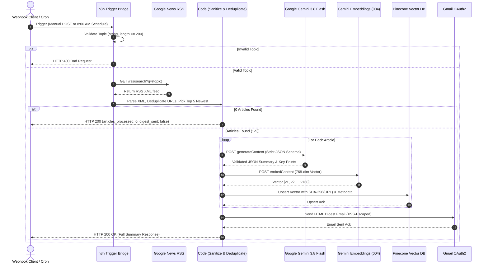
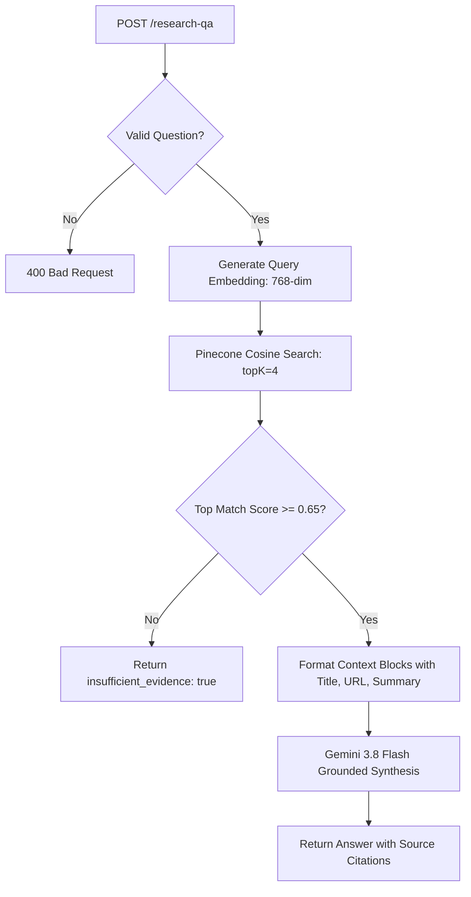

# System Architecture: AI Research Automation Pipeline

This document details the architectural design, data models, vector retrieval mechanics, and failure modes of the AI Research Automation Pipeline built on **n8n**, **Google Gemini**, **Pinecone**, and **Gmail**.

---

## 1. Architectural Overview for Web Developers

If you come from a backend web development background (e.g., Express, FastAPI, Django), thinking about n8n workflows is directly analogous to writing modular API routes, services, and background workers:

| Web Development Concept | n8n Component | Pipeline Role |
| :--- | :--- | :--- |
| **Route Handler / Controller** | Webhook Node (`POST /research`, `POST /research-qa`) | Ingests JSON payloads, parses query parameters, and returns HTTP responses |
| **Cron Job / Celery Beat** | Schedule Trigger (8:00 AM Daily) | Dispatches recurring background research execution |
| **Input Validation Middleware** | Code Node (`Normalize & Validate`) + IF Node | Validates field presence, types, and string bounds; short-circuits on errors (HTTP 400) |
| **External HTTP Client (`fetch`/`axios`)** | HTTP Request Node | Communicates with Google News RSS, Google Gemini REST API, and Pinecone REST API |
| **Vector Database & ORM** | Pinecone Index (`namespace: research`) | Indexes 768-dimensional document vectors for approximate nearest-neighbor search |
| **Mailer Service (`nodemailer`/SendGrid)** | Gmail Node | Formats and dispatches modern HTML emails via Google OAuth2 |
| **Global Error Boundary / Middleware** | Error Trigger Workflow | Intercepts uncaught runtime failures, sanitizes stack traces, and triggers admin alerts |

---

## 2. End-to-End Workflow Lifecycles

### Workflow 1: AI Research Pipeline Lifecycle



---

## 3. Vector Embeddings & Semantic Search (RAG)

### What Are Text Embeddings?
An embedding transforms unstructured text (such as an article title, summary, or user question) into a high-dimensional vector $\vec{v} \in \mathbb{R}^{768}$. Words and concepts that share semantic context reside closer together in this mathematical vector space.

In this pipeline:
- **Model**: Google `text-embedding-004` (or `gemini-embedding-001` with Matryoshka dimension scaled to 768).
- **Dimension**: `768`.
- **Distance Metric**: `Cosine Similarity`.

$$\text{Cosine Similarity}(\vec{A}, \vec{B}) = \frac{\vec{A} \cdot \vec{B}}{\|\vec{A}\| \|\vec{B}\|}$$

### Idempotency & Deterministic Vector IDs
To prevent repeated daily runs or overlapping webhook requests from polluting the vector database with duplicate records, each article vector is assigned an immutable, deterministic ID:

$$\text{Vector ID} = \text{SHA-256}(\text{Canonical Source URL})$$

When Pinecone receives an upsert with an existing ID, it updates the record in-place rather than creating an extraneous entry.

### Metadata Schema Stored with Each Vector
Every vector stored in Pinecone includes a queryable JSON metadata payload:
```json
{
  "title": "Perimeter Institute Launches New Physics-Driven AI Initiative",
  "summary": "Perimeter Institute has established an interdisciplinary initiative...",
  "key_points": [
    "Unifies theoretical physics research with neural network development",
    "Targeting algorithmic breakthroughs for quantum simulators"
  ],
  "source_url": "https://news.google.com/rss/articles/CBMioAFBVV95cUxNRm0...",
  "topic": "quantum computing",
  "published_at": "2026-10-22T22:30:37.000Z",
  "source_name": "HPCwire"
}
```

---

## 4. Question Answering & Grounded Synthesis (RAG)

Workflow 2 implements Retrieval-Augmented Generation (RAG) with strict epistemic boundaries:



### Preventing AI Hallucinations
1. **Relevance Thresholding**: If the highest match score is below `0.65`, the workflow **does not contact the LLM**. It immediately returns:
   ```json
   {
     "success": true,
     "question": "...",
     "answer": "I do not have sufficient research in the database to answer this question. No indexed articles met the relevance threshold for your query.",
     "sources": [],
     "insufficient_evidence": true
   }
   ```
2. **Strict System Prompt Constraints**: The model is instructed:
   - "Answer the question based strictly on the provided research context."
   - "Do not invent or assume facts not directly stated in the context."
   - "Cite supporting source titles or URLs for major claims."

---

## 5. Security Architecture

1. **Untrusted Data Isolation**: Article titles, descriptions, and RSS XML are treated as untrusted user input. They are never evaluated as code, and all HTML entities and tags are stripped before feeding to Gemini or rendering in emails.
2. **Email HTML Escaping**: All variables rendered in the HTML digest pass through a strict character escape filter (`&`, `<`, `>`, `"`, `'`) to prevent Stored Cross-Site Scripting (XSS).
3. **Secret Redaction in Error Notifications**: Workflow 3 scans runtime stack traces and error messages for API key patterns (e.g. `AIza...`, `pcsk_...`, `Bearer...`) and masks them before delivering alerts to admin inboxes.
4. **No Secrets in Source Control**: All workflow JSON files reference environment variables (`$env.GEMINI_API_KEY`) or n8n credential managers (`gmailOAuth2`, `pineconeApi`). No keys are hardcoded in exports.
